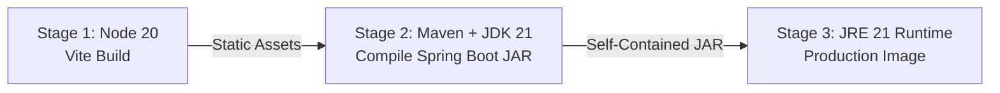

# ChessMind

A distributed, full-stack chess platform and decision-engine built with Java 21, Spring Boot, and React 18. The platform features an immutable board state representation, algorithmic move search with Alpha-Beta pruning, and a decoupled RESTful presentation layer.


---

## Executive Overview

ChessMind was engineered to demonstrate core systems design, functional immutability, algorithmic optimization, and clean architectural separation between a domain chess engine and a modern web frontend.

Rather than relying on third-party chess logic libraries (such as chess.js or Stockfish bindings), all rule verification, move transitions, board representations, and adversarial search algorithms were built from scratch in Java 21 using standard design patterns and mathematical heuristics.

---

## System Architecture & Software Design Patterns

The backend follows Domain-Driven Design (DDD) principles and incorporates several foundational Object-Oriented design patterns:

### 1. Flyweight Pattern (`Tile.java`)
- **Problem:** Generating 64 tile allocations for thousands of intermediate boards during minimax recursive search introduces severe garbage collection (GC) overhead.
- **Solution:** An immutable cache of all 64 empty tiles is initialized statically in an immutable map (`EMPTY_TILES_CACHE`). Empty tiles are referenced by index rather than re-instantiated, eliminating runtime allocation pressure.

### 2. Builder Pattern & Functional Immutability (`Board.java`, `Move.java`)
- **Problem:** In-place board mutation requires complex rollbacks during tree traversal, introducing risk of race conditions and dirty read states in concurrent games.
- **Solution:** Every executed move computes and returns a completely new, immutable `Board` instance via `Board.Builder`. This guarantees thread-safety, simplifies state rollbacks (undo), and ensures search evaluations operate without side effects.

### 3. Strategy Pattern (`MoveStrategy.java`, `BoardEvaluator.java`)
- Evaluation heuristics and move selection algorithms are fully decoupled through the `MoveStrategy` and `BoardEvaluator` interfaces.
- The engine can seamlessly swap between standard minimax (`MiniMax.java`) and optimized branch-and-bound search (`AlphaBeta.java`) without altering game orchestration.

### 4. Factory Method Pattern (`Move.MoveFactory`)
- Move instantiation is abstracted behind `MoveFactory.createMove(...)`, dynamically validating coordinates against current board state and mapping them into specialized subclasses (`MajorMove`, `AttackMove`, `PawnPromotion`, `CastleMove`, etc.).

---

## Algorithmic Deep Dive: Engine & Search Heuristics

### Adversarial Search (Minimax with Alpha-Beta Pruning)
The AI opponent evaluates potential move sequences using minimax recursion coupled with alpha-beta branch-and-bound pruning:

$$\alpha \ge \beta \implies \text{Branch Pruned}$$

- **Complexity Reduction:** In standard chess, the average branching factor is $b \approx 35$. A naive minimax search exploring depth $d$ requires $\mathcal{O}(b^d)$ operations. With optimal move ordering, alpha-beta pruning reduces time complexity to $\mathcal{O}(b^{d/2})$, effectively doubling search depth within identical computational budgets.
- **Dynamic Depth Scaling:** Search depth is configurable dynamically from depth 1 through 5, allowing fine-grained calibration between response latency and tactical evaluation depth.

### Move Ordering Optimization (`MoveSorter`)
Alpha-beta efficiency is critically dependent on evaluating strong candidate moves early to trigger cutoff thresholds:
- Moves are presorted using Guava's `ComparisonChain` and custom `MoveSorter` heuristics.
- Highest-priority transitions (captures, checks, and major attacks) are sequenced first, allowing the engine to maximize beta cutoffs and eliminate redundant subtrees.

### Evaluation Function (`StandardBoardEvaluator`)
The evaluation function produces a scalar zero-sum position evaluation:

$$\text{Score} = \text{Material} + \text{Mobility} + \text{Check Status} + \text{Castled Bonus}$$

- **Material Value:** Standard point weights (Pawn: 100, Knight: 300, Bishop: 300, Rook: 500, Queen: 900, King: 10000).
- **Mobility Weighting:** Quantifies active board control by calculating the ratio of valid candidate moves available to each player.
- **King Safety & Defensive Positioning:** Applies penalties for check states, high rewards for checkmates, and static bonuses for completed castling moves.

---

## State Management & Game Orchestration

### Thread-Safe Session Store
- Active games are managed in memory through `GameService` using a `ConcurrentHashMap<String, GameSnapshot>`.
- Operations are synchronized at the session level to prevent concurrent move race conditions while preserving high-throughput parallel execution across independent sessions.

### Snapshot History & Two-Ply Undo
- Each game maintains a stack of immutable board states.
- In Player-vs-AI mode, an undo operation automatically pops two plies (one AI transition and one human transition), cleanly restoring the game to the human player's prior turn without state corruption.

### Rule Completeness
- Full implementation of all FIDE regulations:
  - En Passant captures with dynamic pawn jump tracking
  - Castling rights verification (path obstruction and transit check checks)
  - Automatic pawn promotion to Queen
  - Check, checkmate, and stalemate detection
  - Threefold repetition tracking based on board hash state histories

---

## REST API Specification

All backend endpoints are exposed under `/api/chess`:

| Method | Endpoint | Request Body | Description |
|---|---|---|---|
| `POST` | `/api/chess/new` | `{ vsAi: boolean, aiDepth: number }` | Initializes a new game session and returns state. |
| `GET` | `/api/chess/state/{gameId}` | *None* | Retrieves current board state, move history, and turn. |
| `POST` | `/api/chess/legal-moves` | `{ gameId: string, tileCoordinate: number }` | Returns array of valid target coordinates for a selected tile. |
| `POST` | `/api/chess/move` | `{ gameId: string, fromCoordinate: number, toCoordinate: number, aiDepth: number }` | Executes a player move; triggers automated AI response if enabled. |
| `POST` | `/api/chess/ai-move/{gameId}` | *None* | Explicitly triggers an AI computation and execution step. |
| `POST` | `/api/chess/undo/{gameId}` | *None* | Reverts the game state to the preceding player turn. |
| `POST` | `/api/chess/reset/{gameId}` | *None* | Resets the current session to the standard board layout. |

---

## Frontend Architecture

- **Framework:** React 18 with Vite for optimized builds and fast refresh.
- **Design System:** Modular CSS architecture with design tokens supporting dynamic themes (Classic Green, Wood, Ocean Blue, Slate).
- **Performance:** Piece symbols render using native Unicode glyphs with CSS hardware acceleration, avoiding external asset load latency.
- **Audio Integration:** Real-time event-driven audio feedback for move, capture, check, and game-over events.
- **PGN Export:** Built-in client-side serializer converting session move histories into standard Portable Game Notation (.pgn) downloads.

---

## Production Deployment & DevOps

### Multi-Stage Dockerfile
The repository includes a production-grade 3-stage `Dockerfile` designed for minimal container image size and strict dependency isolation:



1. **Stage 1 (Node 20):** Compiles React application and builds production bundles into `/dist`.
2. **Stage 2 (Maven + Eclipse Temurin 21):** Copies frontend static assets into Spring Boot's `src/main/resources/static` and packages an executable fat JAR.
3. **Stage 3 (Eclipse Temurin 21 JRE Alpine):** Copies only the compiled artifact into a stripped runtime container, eliminating Node.js, npm, Maven, and compiler dependencies from the final image.

---

## Local Development & Setup

### Prerequisites
- Java Development Kit (JDK) 21 or higher
- Node.js 18+ and npm
- Git

### Running with Docker

```bash
# Build the unified container
docker build -t chessmind-app .

# Run the container
docker run -p 8080:8080 chessmind-app
```
Access the application at `http://localhost:8080`.

### Running in Development Mode

**Backend (Spring Boot):**
```bash
cd chessengine
./mvnw spring-boot:run
```
*API server runs at `http://localhost:8080`.*

**Frontend (React + Vite):**
```bash
cd chess-frontend
npm install
npm run dev
```
*Development server runs at `http://localhost:5173` with automatic API proxying to `http://localhost:8080`.*

---

## Key Interview Talking Points

- **Concurrency & State:** Why immutable board representations eliminate dirty-read bugs and simplify undo mechanics compared to mutating an 8x8 matrix in place.
- **Memory Optimization:** How static flyweight caches for empty tiles reduce garbage collection pauses during recursive minimax evaluation loops.
- **Pruning Mathematics:** How move ordering heuristics reduce effective branching factor and enable deeper search depths within deterministic response thresholds.
- **Architectural Decoupling:** Complete separation of concerns: domain engine logic contains zero web or framework dependencies, facilitating independent testing and portability.
